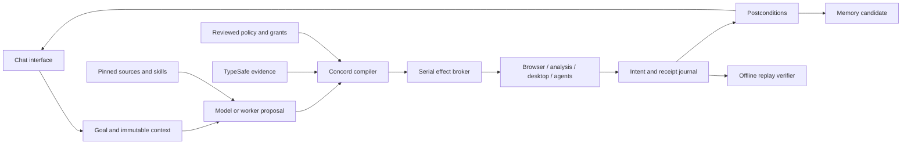

# Unified architecture and feature synthesis

The goal is to carry forward the features and ideas of every supplied project into a novel deterministic harness. Concord retains all acquired source files, including features outside the first kernel. **Source availability**, **design adoption**, **adapter fixture validation**, and **native runtime validation** are distinct states.

## Integration mechanism

The primary interface is chat. A turn combines all twelve reviewed instruction modules, relevant acquired skills/references, the permitted tool declarations, bounded conversation history and tool-result evidence. The same inputs select the same references and produce the same context identity. A live model then returns a reply and optional plan as data. The chat broker exposes protected operations for exact review, runs approved plans through the kernel, and brings result evidence into the following turn.

A plan is a frozen DAG. Nodes name a tool, JSON input, direct dependencies and optional output schema. References resolve only from committed direct-dependency results. The kernel validates the graph before effects, then runs ready nodes serially with a stable tie-break.

Operation identity binds the plan, normalized policy, source catalog, tool configuration, function declarations and explicit workspace. The CLI also binds exact Concord source bytes and Node runtime identity. Corpus selection binds the capability inventory digest. External binaries and model weights need their own content/version pins.

The model proposes; the structured judge advises; the kernel authorizes and schedules. Verification and postconditions determine whether dependents proceed. Experience produces an inert memory candidate. Promotion is a separate write under an exact grant, keeping learned text from becoming authority. An offline demonstration exercises the same context and tool broker while explicitly identifying that it is not live inference.

## Feature synthesis

| Source | Features and ideas retained | Concord implementation status |
| --- | --- | --- |
| ECC | Research, planning, specialized agents, TDD, hooks, reviews, evaluation, memory, continuous learning | Source corpus; inert imports; verification and memory primitives. Host hook execution deferred. |
| ego-lite | Logged-in browser context, task spaces, snapshots, element references, screenshots, CDP | Source corpus; browser receipt boundary designed; native host unverified. |
| REA | Native/managed/JS/browser inspection, provider discovery, normalized evidence, bundles, provenance | Source corpus; process bridge available; dedicated MCP/session adapter deferred. |
| 21st and 21st.dev | Registry, previews, shadcn acquisition, search, dependency/license metadata | Repository corpus; asset acquisition deferred. Hosted components retain individual terms. |
| Vercel skills | Cross-agent discovery, imports, scopes, updates, locks, removal | Source corpus; snapshots/expected digests implemented; global lifecycle deferred. |
| Orca | Worktrees, agents, terminals, browser, desktop/mobile/SSH, review, orchestration | Source corpus; process bridge; native running ADE not installed. |
| TypeSafe | Choice/score/yes-no judgments, confidence, distributions, model routing | Version-pinned HTTP adapter tested with local fixtures; live service not called. |
| Hermes | Persistent agents, skills, learning, memory, delegation, schedules, channels, terminal backends, evaluations | Source corpus; memory primitives; daemon-aware ACP bridge deferred. |
| DeepSeek Harness | Plugins, model/tool services, sessions, events, SDK, ACP, model fixtures | Source corpus; SDK lifecycle adapter fixture-tested; native provider unverified. |
| awesome-cyber-skills | Categorized training labs, difficulty levels and learning references | Full source corpus and reference inventory; linked labs remain external. |
| Awesome-Hacking | Tools, learning resources, labs, categorized links | Source corpus and reference inventory; linked projects remain independent. |

The harvested inventory names individual skills, commands, agent/plugin definitions and documentation headings, including capabilities not reimplemented by Concord. Entries explicitly say `source-available-unreviewed`.

## Runtime ownership

Hermes, DeepSeek and Orca have different session, scheduler and state assumptions. Concord owns the graph and treats delegated workers as approved process effects. Worker internal actions remain outside per-tool enforcement unless a future bridge mediates them. The process contract is an explicit aggregate capability, not a sandbox.

## Reproducibility

1. **Plan determinism:** identical validated inputs, policy, declarations and snapshots give the same order and authorization decisions.
2. **Recorded replay:** identical context plus an anchored journal yields the same accepted recorded result without effects.
3. **Live repeatability:** not guaranteed for models, browsers, servers or devices.
4. **Environment reproduction:** requires pinned binaries, dependencies, model artifacts and isolated machines beyond the kernel.

Canonical JSON is Concord's JavaScript JSON domain, not an implementation claim for RFC 8785 or cross-language numeric canonicalization. Live deadlines produce recorded outcomes. Website observations cannot stand in for immutable asset snapshots.

## Durability

With `--journal`, the kernel exclusively creates a JSONL sink and fsyncs the header and each event. The CLI reserves the final run file before effects. A crash may leave an empty envelope and a partial intent log. Partial logs are forensic evidence; replay accepts complete settled envelopes only. Automatic retry/resume of interrupted effects is absent. Future durable retries need idempotency keys and reconciliation.

## Chat context and review

Instruction modules are original reviewed syntheses with pinned source citations. Imported source skill text remains untrusted reference material and cannot override the supervisor. Context selection has deterministic lexical scoring, tie-breaks, snippet limits, and a history window with a commitment to omitted messages. The model request and resulting tool proposal are separate authorization stages.

The local UI shows selected references, available tools, proposed plans, exact blocked operations and recorded runs. The server serves only its three application assets and narrow JSON APIs on loopback; state-changing APIs require the instance token and the expected local origin. It does not expose the upstream tree or a general filesystem endpoint.

Chat records persist locally. Successful receipts can be replayed without tool execution; the current process keeps the original replay context. Restart reconstruction and uncertain-effect recovery remain explicit future modules rather than silently retrying actions.

## Remaining modules

Preserving sources does not complete a port of every upstream feature. Next dedicated adapters: REA MCP handshake/evidence export; ego task-space lifecycle; Orca task/dispatch receipts; Hermes daemon-aware ACP; 21st asset/license acquisition. Further modules include worker isolation, queue/schedule persistence, review UI, provider adapters, persistent memory stores, eval suites, remote channels and reviewed skill updates. Each must preserve the kernel contract and pass native runtime tests before being called operational.

The novelty is this particular integration kernel and consistent evidence/authorization boundary. It is not a claim of an unprecedented AI algorithm or deterministic fresh inference.
