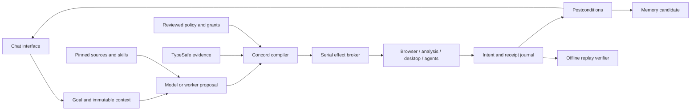

# Unified architecture and feature synthesis

The goal is to carry forward the features and ideas of every supplied project into a novel deterministic harness. Concord retains all acquired source files, including features outside the first kernel. **Source availability**, **design adoption**, **adapter fixture validation**, and **native runtime validation** are distinct states.

## Integration mechanism

The primary interface is chat. A turn combines all thirteen reviewed instruction modules, relevant acquired skills/references, the permitted tool declarations, bounded conversation history and tool-result evidence. The same inputs select the same references and produce the same context identity. A live model then returns a reply and optional plan as data. The chat broker exposes protected operations for exact review, runs approved plans through the kernel, and brings result evidence into the following turn.

A plan is a frozen DAG. Nodes name a tool, JSON input, direct dependencies and optional output schema. References resolve only from committed direct-dependency results. The kernel validates the graph before effects, then runs ready nodes serially with a stable tie-break.

Operation identity binds the plan, normalized policy, source catalog, tool configuration, function declarations and explicit workspace. The CLI also binds exact Concord source bytes and Node runtime identity. Corpus selection binds the capability inventory digest. External binaries and model weights need their own content/version pins.

The model proposes; the structured judge advises; the kernel authorizes and schedules. Verification and postconditions determine whether dependents proceed. Experience produces an inert memory candidate. Promotion is a separate write under an exact grant, keeping learned text from becoming authority. There is no demonstration mode: with no model registered a turn refuses with CHAT_NO_MODEL rather than answering from pure tools, because a harness that looks like it is working when it is not is the confusion this project exists to refuse.

## Feature synthesis

| Source | Features and ideas retained | Concord implementation status |
| --- | --- | --- |
| ECC | Research, planning, specialized agents, TDD, hooks, reviews, evaluation, memory, continuous learning | Source corpus; inert imports; verification and memory primitives; skill bodies reach chat replies via a recorded `skills.snapshot` enrichment plan. Hook rules are now native and pure: `hooks.evaluate` matches a rule set against a tool-call event and returns the strictest matching decision with its reasons. It decides and does not enforce, and runs no host command on any tool-call boundary — hidden control flow is the thing this kernel exists to remove. |
| ego-lite | Logged-in browser context, task spaces, snapshots, element references, screenshots, CDP | Native `browser.snapshot` and `browser.automate` process tools: launch a configured local Chrome/Chromium, drive it over raw CDP, and either extract a bounded text snapshot or run a bounded click/fill/wait/extract action sequence inside one CDP session — both verified end-to-end against a real local browser. `browser.automate` passes selector/value data only as CDP `Runtime.callFunctionOn` arguments, never interpolated into executable script. No shared logins, persistent profiles, or any session held open across two separate calls in this version (a deliberate replay-safety boundary — see below). |
| ego-lite (web) | Fetching and searching the open web as part of a task | Native `web.fetch` and `web.search` network tools: a zero-dependency GET that records the digest of exactly the bytes received, the whole redirect chain, and the named reduction that produced the text, with `policy.allowedOrigins` re-checked at every hop and no credential or cookie ever sent; and a search that asks every configured engine inside one bounded call and returns a corroboration table — which engines returned each page, at what rank, how many agreed — rather than one engine's ranking, with a failing engine reported as data and total failure as a refusal. See [the web tools](web.md). |
| Orca (build) | Building, testing and comparing what a build produced | Native `build.detect` (read), `build.run` (process) and `build.compare` (pure): detection reports each marker with its digest and separates what is present from what has a reviewed target behind it; a run returns a receipt binding every declared input digest to every declared artifact digest, with each diagnostic bound to the SHA-256 of the file it blames as the build saw it, and a non-zero exit returned as the result rather than thrown; and the comparison separates "the inputs changed" from "the output bytes changed", so an edit that never reached the output and a build that is not reproducible from its declared inputs are distinguishable. See [building as an attestation](build.md). |
| REA | Native/managed/JS/browser inspection, provider discovery, normalized evidence, bundles, provenance | All 117 declared REA tools are internal: 49 zero-dependency readers (ELF/PE/Mach-O, DEX/APK/AXML, ECMA-335 .NET metadata, SQLite, pcap, WASM, EVM, source maps, HAR, firmware, Dart, Electron fuses, plists, HarmonyOS, ELF core dumps) and 68 realized by bounded calls to operator-reviewed binaries, where the argv shape is the operator's and only pattern-checked slot values come from a plan. See [taking REA's capabilities internally](rea-internal.md). |
| 21st and 21st.dev | Registry, previews, shadcn acquisition, search, dependency/license metadata | Native UI-component registry network tool (`ui.components.search`): Concord's own defined request/response contract with real schema enforcement, fixture-tested; real 21st.dev wire compatibility unverified. Hosted components retain individual terms. |
| Vercel skills | Cross-agent discovery, imports, scopes, updates, locks, removal | Native lifecycle: `skills.install` verifies a file against the digest the inventory recorded before copying it and writes a lock carrying source id, upstream path and install-time digest; `skills.installed` answers two separate questions — has my copy changed, has upstream moved on — rather than collapsing them; `skills.remove` takes file and lock entry and reports when they disagreed. An installed skill is inert text: installing executes nothing, and an unreviewed source stays unreviewed. |
| Orca | Worktrees, agents, terminals, browser, desktop/mobile/SSH, review, orchestration | Native `process.run` and `process.runMany` process tools: a generic bounded local-command runner, fixture-tested, plus concurrent execution of several named reviewed commands inside one call (real OS-level parallelism, internal to one atomic replay-safe tool call — not a kernel scheduling change) with per-child output-budget division and partial failures returned as data. Orca's own worktree/terminal/desktop/mobile/SSH session model is not implemented. |
| TypeSafe | Choice/score/yes-no judgments, confidence, distributions, model routing | Version-pinned HTTP adapter tested with local fixtures; live service not called. Rubric content (labels, choice sets, score levels) is already fully caller-supplied per call, not a separate feature to add — see `examples/typesafe-custom-rubric.plan.json`. |
| Hermes | Persistent agents, skills, learning, memory, delegation, schedules, channels, terminal backends, evaluations | Native `memory.promote`/`memory.recall`: a persistent, content-addressed store with idempotent promotion and lexical recall, and each chat turn auto-splices the best-scoring stored lesson into context. Delegation is now native: `agent.delegate` runs a sub-plan against a registry without itself in it and with **no approvals**, so a write, network or process step comes back as a recorded `blocked` event rather than running on borrowed authority. Scheduling is native as data: `schedule.declare` records intent and `schedule.due` answers against a time the caller supplies, because the kernel never reads a clock — nothing fires by itself. Channels are the peer exchange (`peer.post`/`peer.inbox`, `peer.tell`). Terminal backends remain source corpus only. |
| DeepSeek Harness | Plugins, model/tool services, sessions, events, SDK, ACP, model fixtures | Source corpus; SDK lifecycle adapter fixture-tested; native provider unverified. `dsh` now accepts one or several named, versioned services, with a pure `dsh.catalog` tool exposing their name/version/provider/model as discoverable inert data (never secrets or paths). Runtime hot-swap of an unreviewed service is a deliberate non-goal: it would break `replayPlan`'s registry-digest check between a run and its replay. |
| awesome-cyber-skills | Categorized training labs, difficulty levels and learning references | Full source corpus and reference inventory; linked labs remain external. |
| Awesome-Hacking | Tools, learning resources, labs, categorized links | Source corpus and reference inventory; linked projects remain independent. |

The harvested inventory names individual skills, commands, agent/plugin definitions and documentation headings, including capabilities not reimplemented by Concord. Entries explicitly say `source-available-unreviewed`.

## Runtime ownership

Hermes, DeepSeek and Orca have different session, scheduler and state assumptions. Concord owns the graph and treats delegated workers as approved process effects. Worker internal actions remain outside per-tool enforcement unless a future bridge mediates them. The process contract is an explicit aggregate capability, not a sandbox.

## Reproducibility

1. **Plan determinism:** identical validated inputs, policy, declarations and snapshots give the same order and authorization decisions.
2. **Recorded replay:** identical context plus an anchored journal yields the same accepted recorded result without effects.
3. **Live repeatability:** not guaranteed for models, browsers, servers or devices.
4. **Environment reproduction:** requires pinned binaries, dependencies, model artifacts and isolated machines beyond the kernel.

Canonical JSON is Concord's JavaScript JSON domain, not an implementation claim for RFC 8785 or cross-language numeric canonicalization. Live deadlines produce recorded outcomes. Website observations cannot stand in for immutable asset snapshots.

## Durability

**Granting one approval at a time re-runs the plan.** A task that blocks does not execute on that
run; it executes on the run whose approvals carry its hash, and on every run after that. So a plan
with two effects is run three times to collect two grants, and the first effect is reached a second
time on the final pass. Where that effect is not idempotent the kernel refuses the task with
`EFFECT_INDETERMINATE` rather than applying it twice — `files.write` creates exclusively and never
replaces, so its outcome cannot be re-established and saying so is the only honest answer.
Collecting every hash up front is not a workaround: a request hash binds the *resolved* input, and
a later task's input can depend on an earlier task's output, which does not exist until that
earlier effect has run. A long-horizon plan therefore keeps to one effect per run, or its effects
are idempotent by construction — `schedule.declare` replacing by id, `memory.promote` writing to
the path its own content digest names. A plan with a single effect is unaffected: it blocks before
executing anything and the granted run performs it exactly once.

The chat layer refuses the problem outright rather than meeting it: a proposal carrying more than
one approval-requiring task is rejected `PLAN_UNEXECUTABLE`, with the reason stated in the message
and the offending tools named. **So a long job is a chain of single-effect plans**, and the schedule
store is what joins them: a stage declares its successor as data, the next stage is found by asking
`schedule.due` rather than handed along in memory, and the plan that comes back is pinned by the
digest the earlier stage recorded. A job in that shape survives the process ending between any two
stages, needs one approval per stage, and never reaches `EFFECT_INDETERMINATE`. The cost is stated
plainly: three stages means three approvals and three runs, and nothing advances a stage by itself,
because there is no daemon and being due is a statement about a time the caller supplied rather
than an event that fired. `scripts/train-exercises-horizon.mjs` runs exactly that three-stage job
each round.

With `--journal`, the kernel exclusively creates a JSONL sink and fsyncs the header and each event. The CLI reserves the final run file before effects. A crash may leave an empty envelope and a partial intent log. Partial logs are forensic evidence; replay accepts complete settled envelopes only. Automatic retry/resume of interrupted effects is absent. Future durable retries need idempotency keys and reconciliation.

## Chat context and review

Instruction modules are original reviewed syntheses with pinned source citations. Imported source skill text remains untrusted reference material and cannot override the supervisor. Context selection has deterministic lexical scoring, tie-breaks, snippet limits, and a history window with a commitment to omitted messages. The model request and resulting tool proposal are separate authorization stages.

The local UI shows selected references, available tools, proposed plans, exact blocked operations and recorded runs. The server serves only its three application assets and narrow JSON APIs on loopback; state-changing APIs require the instance token and the expected local origin. It does not expose the upstream tree or a general filesystem endpoint.

Chat records persist locally. Successful receipts can be replayed without tool execution; the current process keeps the original replay context. Restart reconstruction and uncertain-effect recovery remain explicit future modules rather than silently retrying actions.

Recorded runs are also comparable to each other. `variant.contrast` and `variant.select` run the task-level propose/probe/compose cycle over *plans* rather than over harness configuration, because policy, registry and source digests are what every approval hash and replay check binds — a harness that edited itself mid-run would invalidate its own grant. The same header digests that make that edit impossible are what let a contrast prove only the plan differed, and a selection may cite no field the contrast did not observe. See [variants](variants.md).

## Remaining modules

Preserving sources does not complete a port of every upstream feature. Next dedicated adapters: REA MCP handshake/evidence export; ego task-space lifecycle; Orca task/dispatch receipts; Hermes daemon-aware ACP; 21st asset/license acquisition. Further modules include worker isolation, queue/schedule persistence, review UI, provider adapters, persistent memory stores, eval suites, remote channels and reviewed skill updates. Each must preserve the kernel contract and pass native runtime tests before being called operational.

The novelty is this particular integration kernel and consistent evidence/authorization boundary. It is not a claim of an unprecedented AI algorithm or deterministic fresh inference.
